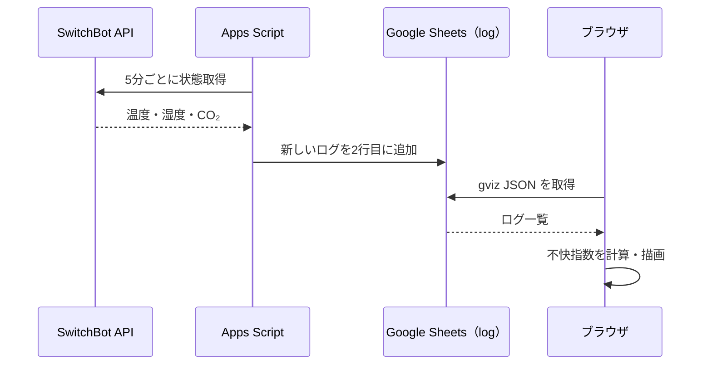

# 画面・データ仕様

## 概要

SwitchBot CO₂センサー（温湿度計）のデータをGoogle Sheets経由で取得し、ブラウザに最新値・集計値・時系列グラフを表示します。ブラウザは読み取り専用で、SwitchBot APIに直接アクセスしません。

## データの流れ



- `apps_script/src/code.gs` は時間主導型のトリガーで実行します。トリガーの設定そのものはリポジトリから自動では行いません。
- `log` シートは最大2016データ行＋ヘッダーを保持します（正常に5分間隔で記録できた場合は約1週間）。
- 新しいログは2行目に挿入し、古いデータは下に移動します。

## シートの列

| 列 | ヘッダー | 意味 | 例 |
| --- | --- | --- | --- |
| A | `timestamp` | UNIX秒 | `1739251200` |
| B | `temperature` | 温度（°C） | `23.5` |
| C | `humidity` | 相対湿度（%） | `55` |
| D | `co2` | CO₂濃度（ppm） | `780` |

フロントはA～D列から `LogRow` を作り、欠損値・数値変換できないセルを `null` とします。不快指数はシートに保存せず、次の式で計算して小数第1位に丸めます。

```text
不快指数 = 0.81 × 温度 + 0.01 × 湿度 × (0.99 × 温度 - 14.3) + 46.3
```

温度・湿度のどちらかがない場合、不快指数は `null` です。

## 画面

### 最新値

- 温度・湿度・不快指数・CO₂濃度の4カードを表示します。
- ログ全体の中で、日時として解釈できるタイムスタンプが最も新しい行を最新値に使用します。
- 計測時刻と、ブラウザがデータを取得した時刻は区別して表示します。
- CO₂の補助ラベルは `600以下: 良好 / 800以下: 通常 / 1000以下: 換気の目安 / 1000超: 換気を推奨` です。一般的な画面上の目安であり、安全性の保証ではありません。
- 不快指数の補助ラベルは値に応じて寒い・快適・暑い等を表示します。

### 気温サマリー

- 最終記録を含む**直近288件**から有効な気温の最高・最低を計算します。
- 約24時間という表記は5分間隔の正常収集を前提としています。欠測や記録間隔のずれがある場合、実時間の24時間を意味しません。

### 時系列グラフ

| 表示名 | 対象件数 |
| --- | ---: |
| 1時間 | 12件 |
| 12時間 | 144件 |
| 1日（初期値） | 288件 |
| 1週間 | 2016件 |

- 表示用データは日時の昇順に並べ、最新のN件を取り出します。日時を解釈できない行は除外します。
- グラフは4つ、縦軸はそれぞれの実測値に余白を加えた範囲を表示します。
- 欠損値を無理に補間せず、表示可能なポイントがない場合は空状態を表示します。
- 期間の切り替えは追加の通信をせず、既に取得した行を使用します。

## 取得とエラー

- 初回表示でGoogle Sheetsからデータを取得します。通常時の手動更新ボタンや自動ポーリングはありません。最新データを取得したい場合はページを再読み込みします。
- 取得に失敗した場合はエラーメッセージと再試行ボタンを表示します。過去の取得に成功している場合、そのデータは保持します。
- シートID・gvizのレスポンス仕様・読み取り共有設定は外部依存です。閲覧者のブラウザが直接アクセスできる必要があります。

## レスポンシブ対応

- デスクトップ: 4つの最新値カードを横並び、グラフは2列。
- 中程度の画面: 最新値カードは2列。
- スマートフォン: 最新値カード2列、グラフは1列、期間ボタンを一列に配置。
- キーボード操作、ボタンのフォーカス表示、エラーの `role=alert`、OSの動きを減らす設定に配慮します。
